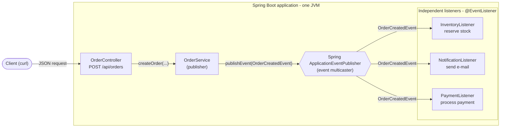
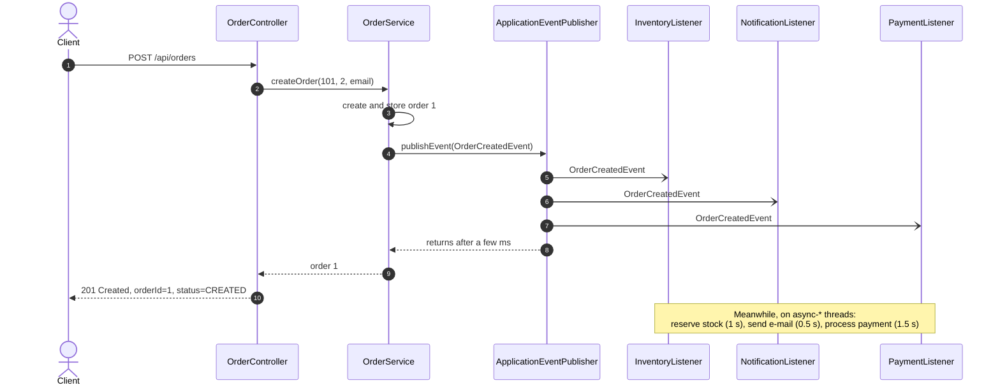

# Event-Driven Order Management with Spring Application Events

A small, runnable **Java 21 / Spring Boot 3** project that shows how components can talk to each other
through **events** instead of calling each other directly.

When a customer places an order, `OrderService` creates it and *announces* it by publishing an
`OrderCreatedEvent`. Three independent listeners react to that event: one reserves stock, one sends a
confirmation e-mail and one processes the payment. `OrderService` doesn't know that any of them exist.

No Kafka, no RabbitMQ, no database: only Spring's built-in application events.

**Stack:** Java 21 · Spring Boot 3.5 (Spring Web) · Gradle 9.7.1 with Kotlin DSL (wrapper included)

**Contents:**
[Core concepts](#core-concepts-in-one-minute) ·
[Architecture](#architecture) ·
[Project structure](#project-structure) ·
[Run it](#run-it) ·
[What the console shows](#what-the-console-shows) ·
[Questions & answers](#questions--answers) ·
[What's left out](#whats-intentionally-left-out) ·
[Troubleshooting](#troubleshooting)

---

## Core concepts in one minute

| Concept | What it means | In this project |
|---|---|---|
| **Event-Driven Architecture (EDA)** | Components communicate by publishing and reacting to *events* instead of calling each other directly. | `OrderService` publishes, three listeners react. |
| **Event** | An immutable message describing something that **has already happened**, named in the past tense. | `OrderCreatedEvent` (a Java `record`) |
| **Event publisher** (producer) | Announces that something happened. It doesn't know who is listening, or whether anyone is. | `OrderService`, using Spring's `ApplicationEventPublisher` |
| **Event listener** (consumer) | Reacts to the events it is interested in. It doesn't know who published them. | `InventoryListener`, `NotificationListener`, `PaymentListener` (`@EventListener`) |
| **Event bus** | Delivers each event from the publisher to the interested listeners. | The Spring `ApplicationContext` (internally: its `ApplicationEventMulticaster`) |
| **Asynchronous communication** | The publisher doesn't wait for the listeners; they do their work at the same time, on other threads. | `@EnableAsync` + `@Async` on the listeners |

## Architecture



There is no arrow from `OrderService` to the listeners. The publisher and the listeners only share the
**event class** - that class is the contract between them.

## Project structure

```text
event-driven-playground
├── build.gradle.kts                  # plugins, Java 21 toolchain, dependencies
├── settings.gradle.kts               # project name + automatic JDK download
├── gradlew, gradlew.bat, gradle/     # Gradle Wrapper: no Gradle installation needed
└── src
    ├── main
    │   ├── java/com/example/eventdriven
    │   │   ├── EventDrivenApplication.java     # Spring Boot entry point
    │   │   ├── AsyncConfig.java                # @EnableAsync, switched on/off by app.events.async
    │   │   ├── controller
    │   │   │   └── OrderController.java        # POST /api/orders
    │   │   ├── service
    │   │   │   └── OrderService.java           # creates the order and PUBLISHES the event
    │   │   ├── event
    │   │   │   └── OrderCreatedEvent.java      # the event: an immutable fact
    │   │   ├── listener
    │   │   │   ├── InventoryListener.java      # reserves stock
    │   │   │   ├── NotificationListener.java   # sends the confirmation e-mail
    │   │   │   └── PaymentListener.java        # processes the payment
    │   │   ├── model
    │   │   │   ├── Order.java                  # the domain object
    │   │   │   └── OrderStatus.java
    │   │   └── dto
    │   │       ├── CreateOrderRequest.java     # request body  (API contract)
    │   │       └── CreateOrderResponse.java    # response body (API contract)
    │   └── resources
    │       └── application.properties          # async on/off, thread names, log format
    └── test/java/com/example/eventdriven/service
        └── OrderServiceTest.java               # tests the publisher without any listener
```

## Run it

**You need:** a JDK 21. That's all. The Gradle Wrapper downloads Gradle itself, and if Gradle finds no
JDK 21 on your machine it downloads one automatically (Gradle toolchains + the foojay resolver plugin).

**1. Start the application**

| Shell | Command |
|---|---|
| macOS / Linux / Git Bash | `./gradlew bootRun` |
| Windows Command Prompt | `gradlew.bat bootRun` |
| Windows PowerShell | `.\gradlew.bat bootRun` |

Wait for `Started EventDrivenApplication in ... seconds`. The app listens on port **8080**
(busy? see [Troubleshooting](#troubleshooting)).

**2. Place an order** from a second terminal:

```bash
curl -i -X POST http://localhost:8080/api/orders \
  -H "Content-Type: application/json" \
  -d '{"productId": 101, "quantity": 2, "customerEmail": "customer@example.com"}'
```

Windows PowerShell (in Windows PowerShell 5.1 `curl` is an alias of `Invoke-WebRequest`, so use this instead):

```powershell
Invoke-RestMethod -Method Post -Uri http://localhost:8080/api/orders -ContentType "application/json" -Body '{"productId": 101, "quantity": 2, "customerEmail": "customer@example.com"}'
```

**3. Response**

```http
HTTP/1.1 201
Content-Type: application/json

{"orderId":1,"status":"CREATED"}
```

Every request creates a new order (`orderId` 2, 3, ...). Orders are kept in memory, so they are gone
when you stop the application.

**Run the test:** `./gradlew test` (Windows: `gradlew.bat test`).

## What the console shows

Output of the request above (Spring's startup lines are left out):

```text
23:34:57.984 INFO  [http-nio-8080-exec-1] OrderController      : ==> POST /api/orders CreateOrderRequest[productId=101, quantity=2, customerEmail=customer@example.com]
23:34:57.995 INFO  [http-nio-8080-exec-1] OrderService         : [orderId=1] Order created and stored with status CREATED
23:34:57.996 INFO  [http-nio-8080-exec-1] OrderService         : [orderId=1] Publishing OrderCreatedEvent[orderId=1, productId=101, quantity=2, customerEmail=customer@example.com, occurredAt=2026-11-15T21:34:57.996802100Z]
23:34:58.010 INFO  [async-1]              InventoryListener    : [orderId=1] Received OrderCreatedEvent -> reserving 2 unit(s) of product 101
23:34:58.010 INFO  [async-2]              NotificationListener : [orderId=1] Received OrderCreatedEvent -> sending confirmation email to customer@example.com
23:34:58.011 INFO  [http-nio-8080-exec-1] OrderService         : [orderId=1] publishEvent() returned after 6 ms
23:34:58.011 INFO  [async-3]              PaymentListener      : [orderId=1] Received OrderCreatedEvent -> processing payment for 2 x product 101
23:34:58.011 INFO  [http-nio-8080-exec-1] OrderController      : [orderId=1] <== 201 Created CreateOrderResponse[orderId=1, status=CREATED]
23:34:58.522 INFO  [async-2]              NotificationListener : [orderId=1] Confirmation email sent to customer@example.com
23:34:59.016 INFO  [async-1]              InventoryListener    : [orderId=1] Inventory reserved
23:34:59.512 INFO  [async-3]              PaymentListener      : [orderId=1] Payment processed
```

How to read it:

- **The thread name in brackets tells you *who* runs the code.** `[http-nio-8080-exec-1]` is the Tomcat
  thread that handles the HTTP request. `[async-1]`, `[async-2]` and `[async-3]` are background threads
  from Spring's task executor.
- **`publishEvent() returned after 6 ms`**: the publisher was done almost immediately and did not wait for
  a single listener. In this run two listeners even logged their first line before it returned, because
  they were already running on their own threads. (The exact interleaving differs from run to run.)
- **`<== 201 Created`** was logged *before* any listener had finished: the client already had its answer
  while stock, e-mail and payment were still being processed.
- **The listeners run in parallel.** All three started at `23:34:58.01`, but they finished in a different
  order (e-mail after 0.5 s, inventory after 1 s, payment after 1.5 s), because none of them waits for
  another.
- **Every line starts with a timestamp and carries `[orderId=1]`**, so you can follow one order through
  all components. (`occurredAt` inside the event is an `Instant`, which is printed in UTC.)

---

## Questions & answers

1. [What problem does Event-Driven Architecture solve?](#1-what-problem-does-event-driven-architecture-solve)
2. [How does the example work step by step?](#2-how-does-the-example-work-step-by-step)
3. [What is the responsibility of the publisher?](#3-what-is-the-responsibility-of-the-publisher)
4. [What is the responsibility of each listener?](#4-what-is-the-responsibility-of-each-listener)
5. [Why doesn't OrderService directly call the listeners?](#5-why-doesnt-orderservice-directly-call-the-listeners)
6. [What are the advantages and disadvantages of this approach?](#6-what-are-the-advantages-and-disadvantages-of-this-approach)
7. [Is Spring ApplicationEventPublisher asynchronous by default?](#7-is-spring-applicationeventpublisher-asynchronous-by-default)
8. [What happens if one listener throws an exception?](#8-what-happens-if-one-listener-throws-an-exception)
9. [What is the difference between Spring Application Events and Kafka?](#9-what-is-the-difference-between-spring-application-events-and-kafka)

### 1. What problem does Event-Driven Architecture solve?

Picture the first version of `OrderService`: it creates orders. Then the requirements arrive:
*"also reserve the stock"*, *"also send a confirmation e-mail"*, *"also charge the customer"*, and next
month *"also update the analytics"*, *"also award loyalty points"*... With direct method calls, every one of
them lands in `OrderService`:

- **It depends on everything.** Inventory, e-mail, payment, analytics: a change in any of them can break
  order creation.
- **It never stops growing.** Each new reaction to "an order was placed" means editing, re-testing and
  re-deploying the order code.
- **It is as slow as all its collaborators together, and fails when any of them fails.** A broken mail
  server suddenly stops customers from ordering.

Event-Driven Architecture turns the dependency around. The order code only announces a fact,
*"order 1 was created"*, and every component that cares about that fact subscribes to it. The publisher
does not depend on its consumers, so consumers can be added, removed or changed without touching it.

### 2. How does the example work step by step?

1. `curl` sends `POST /api/orders` with a JSON body.
2. `OrderController` receives it as a `CreateOrderRequest` DTO (Spring + Jackson convert the JSON) and calls
   `orderService.createOrder(...)`.
3. `OrderService` creates the `Order` (id `1`, status `CREATED`) and stores it in memory.
4. `OrderService` builds an `OrderCreatedEvent` containing everything a listener needs (order id, product,
   quantity, e-mail, timestamp) and calls `eventPublisher.publishEvent(event)`.
5. Spring finds every listener method whose parameter type is `OrderCreatedEvent` - the three
   `onOrderCreated(...)` methods - and delivers the event to each of them.
6. The listeners are `@Async`, so Spring only *hands them over* to a thread pool, and `publishEvent()`
   returns right away.
7. `OrderService` returns the order. `OrderController` turns it into a `CreateOrderResponse` DTO and the
   client receives `201 Created` with `{"orderId":1,"status":"CREATED"}`.
8. Meanwhile, on `async-*` threads, the three listeners do their work in parallel and log their progress.



#### What happens inside `publishEvent()`?

**At startup**, Spring prepares the delivery:

1. It creates the beans, including the three listener components.
2. `EventListenerMethodProcessor` scans every bean for methods annotated with `@EventListener`. For each one
   it registers an `ApplicationListenerMethodAdapter` - a small object that remembers *"call
   `onOrderCreated` on the bean `inventoryListener` for events of type `OrderCreatedEvent`"* - with the
   context's `ApplicationEventMulticaster`.
3. Because `@EnableAsync` is active, each listener bean is wrapped in a proxy that sends calls to `@Async`
   methods to the thread pool (Spring Boot's auto-configured `applicationTaskExecutor`).

**At runtime**, `eventPublisher.publishEvent(event)` does this:

1. The injected `ApplicationEventPublisher` *is* the `ApplicationContext` - the context implements that
   interface.
2. `OrderCreatedEvent` is a plain record, not a subclass of `ApplicationEvent`, so Spring wraps it in a
   `PayloadApplicationEvent<OrderCreatedEvent>`.
3. The context passes the event to its `SimpleApplicationEventMulticaster`.
4. The multicaster selects the listeners that accept this event type, by comparing it with each listener
   method's parameter type (the result is cached per event type).
5. It calls those listeners **one after another, in a plain `for` loop, on the current thread**. Each
   adapter unwraps the payload and invokes `onOrderCreated(event)` via reflection.
6. When the loop is done, `publishEvent()` returns.

The heart of it really is just a loop:

```java
// What SimpleApplicationEventMulticaster does - simplified
for (ApplicationListener<?> listener : getApplicationListeners(event, eventType)) {
    listener.onApplicationEvent(event);   // a normal, blocking method call
}
```

The stack trace in [question 8](#8-what-happens-if-one-listener-throws-an-exception) shows this exact
chain in a real run.

So where does the asynchrony come from? From step 5: the call reaches the `@Async` proxy, which hands the
work to the thread pool and returns immediately. Without `@EnableAsync` the same step runs each listener's
code right there, and `publishEvent()` waits for all of them (see [question 7](#7-is-spring-applicationeventpublisher-asynchronous-by-default)).

### 3. What is the responsibility of the publisher?

`OrderService` is the publisher. Its responsibilities:

- **Do its own job first**: create and store the order. An event announces something that *has
  happened*, so it is published after the work is done.
- **Describe the fact, not the reaction**: the event is `OrderCreatedEvent`, not
  `ReserveInventoryCommand`. The publisher doesn't tell anybody what to do.
- **Put everything the listeners need into the event, and make it immutable**: then listeners never have
  to call back into `OrderService`, and they can safely read the event on other threads.
- **Publish it** with `ApplicationEventPublisher.publishEvent(...)`.

What it is **not** responsible for: knowing who listens, how many listeners there are, what they do, in
which order they run, or whether they succeed.

### 4. What is the responsibility of each listener?

| Listener | Reacts to | Responsibility | Simulated work |
|---|---|---|---|
| `InventoryListener` | `OrderCreatedEvent` | Reserve the ordered quantity of the product. Every product pretends to have 10 units in stock, so ordering more makes it fail (used in [question 8](#8-what-happens-if-one-listener-throws-an-exception)). | 1.0 s |
| `NotificationListener` | `OrderCreatedEvent` | Send the order confirmation e-mail to `customerEmail`. | 0.5 s |
| `PaymentListener` | `OrderCreatedEvent` | Charge the customer for the order. | 1.5 s |

What all three have in common:

- Each has **one job** and only uses the data inside the event.
- None of them knows `OrderService` or the other listeners. They don't call each other and don't rely on
  running before or after each other (Spring guarantees no particular order unless you add `@Order`).
- Each one is responsible for its own failures (see [question 8](#8-what-happens-if-one-listener-throws-an-exception)).
- Nobody registers them anywhere: `@Component` makes them beans, `@EventListener` plus the parameter type
  subscribes them to the event.

### 5. Why doesn't OrderService directly call the listeners?

Because it would then be tightly coupled to all of them. Compare the two styles.

**Direct method invocation** (not used in this project):

```java
@Service
public class OrderService {
    private final InventoryService inventoryService;        // OrderService must know
    private final NotificationService notificationService;  // every collaborator...
    private final PaymentService paymentService;

    public Order createOrder(Long productId, int quantity, String customerEmail) {
        Order order = /* create and store */;
        inventoryService.reserve(order);       // ...waits 1.0 s
        notificationService.sendEmail(order);  // ...waits 0.5 s
        paymentService.charge(order);          // ...waits 1.5 s
        return order;                          // the client gets its answer after 3 s
    }
}
```

**Event-based communication** (this project):

```java
@Service
public class OrderService {
    private final ApplicationEventPublisher eventPublisher;  // the only dependency

    public Order createOrder(Long productId, int quantity, String customerEmail) {
        Order order = /* create and store */;
        eventPublisher.publishEvent(new OrderCreatedEvent(/* ... */));  // "an order was created"
        return order;
    }
}
```

| | Direct method invocation | Event-based communication |
|---|---|---|
| `OrderService` depends on | every collaborator | only `ApplicationEventPublisher` and the event class |
| Adding a new reaction (e.g. analytics) | edit and re-test `OrderService` | add a new `@EventListener` class - `OrderService` is untouched |
| Who decides what happens after an order is created | the caller | each listener, for itself |
| Response time | sum of all calls (about 3 s here) | synchronous events: still about 3 s; `@Async` events: a few ms |
| A collaborator throws an exception | order creation fails | synchronous events: the same; `@Async` events: only that listener fails |
| Unit-testing `OrderService` | needs three mocks | a fake publisher that records events (see `OrderServiceTest`) |
| Following the flow in the IDE | "go to definition" | "find usages" of `OrderCreatedEvent` |

> **Two kinds of decoupling.** Events decouple the **code**: `OrderService` no longer knows the
> listeners. `@Async` additionally decouples **time and failures**: `OrderService` no longer waits for
> them, nor fails with them. Spring gives you the first kind by default; the second only when you ask
> for it.

"Decoupled" does not mean "no dependencies": both sides depend on the event class. If you rename a field
of `OrderCreatedEvent`, every listener that reads it is affected.

**Try it: add a fourth listener without touching `OrderService`.**

```java
package com.example.eventdriven.listener;

import com.example.eventdriven.event.OrderCreatedEvent;
import org.slf4j.Logger;
import org.slf4j.LoggerFactory;
import org.springframework.context.event.EventListener;
import org.springframework.stereotype.Component;

@Component
public class AnalyticsListener {

    private static final Logger log = LoggerFactory.getLogger(AnalyticsListener.class);

    @EventListener
    public void onOrderCreated(OrderCreatedEvent event) {
        log.info("[orderId={}] Recording the sale for analytics", event.orderId());
    }
}
```

Restart, place an order, and the new listener receives the event. It has no `@Async`, so it runs on the
request thread: synchronous and asynchronous listeners can be mixed.

### 6. What are the advantages and disadvantages of this approach?

**Advantages**

- **Loose coupling**: the publisher doesn't know its consumers, and consumers don't know each other.
- **Easy to extend**: a new reaction is a new class; existing code stays untouched (open/closed principle).
- **Single responsibility**: every class has one clear job.
- **Easier testing**: test the publisher by checking which events it publishes; test a listener by
  calling it with an event.
- **With `@Async`, faster responses**: the client doesn't wait for side effects such as e-mails, and the
  listeners work in parallel.
- **With `@Async`, failure isolation**: a failing listener doesn't break order creation or the other
  listeners.

**Disadvantages**

- **Harder to follow**: no single method shows the whole flow. To answer "what happens when an order is
  created?" you have to search for every listener.
- **Harder to debug**: with `@Async` the work is spread over several threads. Thread-bound context
  (logging MDC, security context, transactions) is not carried over to them automatically.
- **No automatic rollback**: if the payment fails, the stock has already been reserved and the e-mail
  sent. You have to design compensating actions yourself, e.g. a `PaymentFailedEvent` that makes inventory
  release the stock.
- **No guaranteed order**: if the business needs a sequence (charge only after the stock is reserved),
  you need a chain of events (`InventoryReservedEvent` → payment) or an explicit orchestrator.
- **Eventual consistency (with `@Async`)**: the client is told `CREATED` while the payment is still running.
- **Events live only in memory**: if the application crashes, events that are still being processed are
  lost. There is no retry and no replay.
- **Easy to overuse**: events that trigger events that trigger events quickly become "event spaghetti".

Rule of thumb: use an event when the publisher really shouldn't care about the reactions (e-mails,
audit logs, analytics, cache updates). Use a direct call when the caller needs the result to continue,
for example to show the customer the final price.

### 7. Is Spring ApplicationEventPublisher asynchronous by default?

**No.** By default `publishEvent()` is **synchronous**:

- the listeners run **on the publisher's thread**, one after another;
- `publishEvent()` returns only when **all** of them have finished;
- an exception thrown by a listener travels back to the publisher;
- the listeners run inside the publisher's transaction, if there is one.

This project is asynchronous only because two things work together:

1. `@EnableAsync` (in `AsyncConfig`) switches on Spring's `@Async` support.
2. `@Async` on each listener method makes Spring run it on the `applicationTaskExecutor`, a thread pool
   that Spring Boot configures automatically (8 threads by default; `application.properties` names them
   `async-1`, `async-2`, ...).

`@Async` without `@EnableAsync` does nothing at all. (Another option is to give the
`ApplicationEventMulticaster` a `TaskExecutor`, which makes *every* listener in the application
asynchronous, including Spring's own. Choosing per listener with `@Async` is usually the better option.)

**See it yourself.** `AsyncConfig` is only loaded when `app.events.async=true`, so you can switch back to
Spring's default without changing any code. Stop the application (`Ctrl+C`) and start it again with:

| Shell | Command |
|---|---|
| macOS / Linux / Git Bash | `./gradlew bootRun --args='--app.events.async=false'` |
| Windows Command Prompt | `gradlew.bat bootRun --args="--app.events.async=false"` |
| Windows PowerShell | `.\gradlew.bat bootRun --args="--app.events.async=false"` |

Send the same request again. Now the console shows:

```text
23:48:57.121 INFO  [http-nio-8080-exec-1] OrderController      : ==> POST /api/orders CreateOrderRequest[productId=101, quantity=2, customerEmail=customer@example.com]
23:48:57.139 INFO  [http-nio-8080-exec-1] OrderService         : [orderId=1] Order created and stored with status CREATED
23:48:57.139 INFO  [http-nio-8080-exec-1] OrderService         : [orderId=1] Publishing OrderCreatedEvent[orderId=1, productId=101, quantity=2, customerEmail=customer@example.com, occurredAt=2026-11-15T21:48:57.139061500Z]
23:48:57.139 INFO  [http-nio-8080-exec-1] InventoryListener    : [orderId=1] Received OrderCreatedEvent -> reserving 2 unit(s) of product 101
23:48:58.153 INFO  [http-nio-8080-exec-1] InventoryListener    : [orderId=1] Inventory reserved
23:48:58.153 INFO  [http-nio-8080-exec-1] NotificationListener : [orderId=1] Received OrderCreatedEvent -> sending confirmation email to customer@example.com
23:48:58.656 INFO  [http-nio-8080-exec-1] NotificationListener : [orderId=1] Confirmation email sent to customer@example.com
23:48:58.656 INFO  [http-nio-8080-exec-1] PaymentListener      : [orderId=1] Received OrderCreatedEvent -> processing payment for 2 x product 101
23:49:00.167 INFO  [http-nio-8080-exec-1] PaymentListener      : [orderId=1] Payment processed
23:49:00.167 INFO  [http-nio-8080-exec-1] OrderService         : [orderId=1] publishEvent() returned after 3028 ms
23:49:00.167 INFO  [http-nio-8080-exec-1] OrderController      : [orderId=1] <== 201 Created CreateOrderResponse[orderId=1, status=CREATED]
```

Compare it with the [asynchronous output](#what-the-console-shows):

- Everything runs on **one thread**, `[http-nio-8080-exec-1]`. There are no `async-*` threads.
- The listeners run **one after the other**: each one starts only when the previous one has finished
  (Spring happened to call them in the order inventory, e-mail, payment).
- `publishEvent()` returned after **3028 ms** (1 + 0.5 + 1.5 s of listener work), and the `201` was
  sent only after the last listener had finished. The client waited more than 3 seconds for its answer
  instead of a few milliseconds.

### 8. What happens if one listener throws an exception?

It depends on how the events are delivered. `InventoryListener` throws an `IllegalStateException` when
more than 10 units are ordered, so you can try both modes:

```bash
curl -i -X POST http://localhost:8080/api/orders \
  -H "Content-Type: application/json" \
  -d '{"productId": 101, "quantity": 50, "customerEmail": "customer@example.com"}'
```

| | Synchronous (Spring's default) | Asynchronous (`@Async`, this project's default) |
|---|---|---|
| Where the exception goes | up through `publishEvent()` into `OrderService` and `OrderController` | to Spring's `AsyncUncaughtExceptionHandler`, which logs it |
| Listeners that hadn't run yet | **skipped** - the delivery loop is aborted | **unaffected** - each runs on its own thread |
| The HTTP client receives | **500 Internal Server Error** | **201 Created** - it never hears about the failure |
| Work that was already done | **not undone** (the order is stored, earlier listeners have run) | **not undone** |

**Asynchronous (default).** The client receives `201` and `{"orderId":2,"status":"CREATED"}`. The console:

```text
23:35:58.134 INFO  [http-nio-8080-exec-8] OrderController      : ==> POST /api/orders CreateOrderRequest[productId=101, quantity=50, customerEmail=customer@example.com]
23:35:58.134 INFO  [http-nio-8080-exec-8] OrderService         : [orderId=2] Order created and stored with status CREATED
23:35:58.134 INFO  [http-nio-8080-exec-8] OrderService         : [orderId=2] Publishing OrderCreatedEvent[orderId=2, productId=101, quantity=50, customerEmail=customer@example.com, occurredAt=2026-11-15T21:35:58.134000100Z]
23:35:58.134 INFO  [async-4]              InventoryListener    : [orderId=2] Received OrderCreatedEvent -> reserving 50 unit(s) of product 101
23:35:58.134 INFO  [http-nio-8080-exec-8] OrderService         : [orderId=2] publishEvent() returned after 0 ms
23:35:58.134 INFO  [async-5]              NotificationListener : [orderId=2] Received OrderCreatedEvent -> sending confirmation email to customer@example.com
23:35:58.134 INFO  [http-nio-8080-exec-8] OrderController      : [orderId=2] <== 201 Created CreateOrderResponse[orderId=2, status=CREATED]
23:35:58.134 INFO  [async-6]              PaymentListener      : [orderId=2] Received OrderCreatedEvent -> processing payment for 50 x product 101
23:35:58.149 ERROR [async-4]              SimpleAsyncUncaughtExceptionHandler : Unexpected exception occurred invoking async method: public void com.example.eventdriven.listener.InventoryListener.onOrderCreated(com.example.eventdriven.event.OrderCreatedEvent) throws java.lang.InterruptedException
java.lang.IllegalStateException: [orderId=2] Not enough stock for product 101: requested 50, available 10
    at com.example.eventdriven.listener.InventoryListener.onOrderCreated(InventoryListener.java:33)
    ... (stack trace shortened)
23:35:58.646 INFO  [async-5]              NotificationListener : [orderId=2] Confirmation email sent to customer@example.com
23:35:59.645 INFO  [async-6]              PaymentListener      : [orderId=2] Payment processed
```

The exception never reached `OrderService`: it was caught on the listener's own thread and only logged.
The other two listeners carried on as if nothing had happened, so the customer got a confirmation e-mail
and was charged for 50 units that are not in stock - and the client was told `CREATED`.

**Synchronous (`--app.events.async=false`).** The client receives an error:

```http
HTTP/1.1 500
Content-Type: application/json

{"timestamp":"2026-11-15T21:49:11.905+00:00","status":500,"error":"Internal Server Error","path":"/api/orders"}
```

The console:

```text
23:49:11.873 INFO  [http-nio-8080-exec-3] OrderController      : ==> POST /api/orders CreateOrderRequest[productId=101, quantity=50, customerEmail=customer@example.com]
23:49:11.873 INFO  [http-nio-8080-exec-3] OrderService         : [orderId=2] Order created and stored with status CREATED
23:49:11.873 INFO  [http-nio-8080-exec-3] OrderService         : [orderId=2] Publishing OrderCreatedEvent[orderId=2, productId=101, quantity=50, customerEmail=customer@example.com, occurredAt=2026-11-15T21:49:11.873863400Z]
23:49:11.873 INFO  [http-nio-8080-exec-3] InventoryListener    : [orderId=2] Received OrderCreatedEvent -> reserving 50 unit(s) of product 101
23:49:11.890 ERROR [http-nio-8080-exec-3] [dispatcherServlet]  : Servlet.service() for servlet [dispatcherServlet] in context with path [] threw exception [Request processing failed: java.lang.IllegalStateException: [orderId=2] Not enough stock for product 101: requested 50, available 10] with root cause
java.lang.IllegalStateException: [orderId=2] Not enough stock for product 101: requested 50, available 10
    at com.example.eventdriven.listener.InventoryListener.onOrderCreated(InventoryListener.java:33)
    at java.base/jdk.internal.reflect.DirectMethodHandleAccessor.invoke(DirectMethodHandleAccessor.java:103)
    at java.base/java.lang.reflect.Method.invoke(Method.java:580)
    at org.springframework.context.event.ApplicationListenerMethodAdapter.doInvoke(ApplicationListenerMethodAdapter.java:383)
    at org.springframework.context.event.ApplicationListenerMethodAdapter.processEvent(ApplicationListenerMethodAdapter.java:255)
    at org.springframework.context.event.ApplicationListenerMethodAdapter.onApplicationEvent(ApplicationListenerMethodAdapter.java:174)
    at org.springframework.context.event.SimpleApplicationEventMulticaster.doInvokeListener(SimpleApplicationEventMulticaster.java:185)
    at org.springframework.context.event.SimpleApplicationEventMulticaster.invokeListener(SimpleApplicationEventMulticaster.java:178)
    at org.springframework.context.event.SimpleApplicationEventMulticaster.multicastEvent(SimpleApplicationEventMulticaster.java:156)
    at org.springframework.context.support.AbstractApplicationContext.publishEvent(AbstractApplicationContext.java:455)
    at org.springframework.context.support.AbstractApplicationContext.publishEvent(AbstractApplicationContext.java:401)
    at com.example.eventdriven.service.OrderService.createOrder(OrderService.java:60)
    at com.example.eventdriven.controller.OrderController.createOrder(OrderController.java:36)
    ... (Spring MVC and Tomcat frames left out)
```

- **Read the stack trace from the bottom up.** It is exactly the chain described in
  [question 2](#what-happens-inside-publishevent): `OrderController` → `OrderService.createOrder` →
  `AbstractApplicationContext.publishEvent` → `SimpleApplicationEventMulticaster.multicastEvent` →
  `ApplicationListenerMethodAdapter` → reflection → `InventoryListener.onOrderCreated`. It all ran on the
  request thread, so the exception travelled back through `OrderService` and `OrderController` to Tomcat,
  which answered `500`.
- **`NotificationListener` and `PaymentListener` never ran.** Spring happened to call `InventoryListener`
  first, and the delivery loop stopped there. Spring doesn't guarantee an order between these listeners:
  in a different order, the e-mail would already have been sent.
- **The order had already been stored** before the event was published, so it exists with status
  `CREATED` - although the client got an error.

Neither result is "correct" on its own - both need a decision from you:

- **Handle errors inside the listener.** Each listener owns its failures: catch the exception, log it,
  retry, or flag the order for manual follow-up.
- **Publish a failure event**, e.g. `InventoryReservationFailedEvent`, so other components can
  compensate: cancel the order, refund the payment, send an apology e-mail.
- **For synchronous listeners**, you can give the `SimpleApplicationEventMulticaster` an `ErrorHandler`
  that logs the exception and carries on with the next listener.
- **With a database**, use `@TransactionalEventListener`: the listener runs only after the transaction
  has committed, so no e-mail is sent for an order that was rolled back.
- **If the work must never get lost**, in-memory events are not enough - see the next question.

### 9. What is the difference between Spring Application Events and Kafka?

Spring application events are a **method-call mechanism inside one application**. Kafka is a
**distributed, durable log of events** shared by many applications.

| | Spring Application Events | Apache Kafka |
|---|---|---|
| Where events travel | inside one JVM (one Spring application) | between applications and machines, over the network |
| Infrastructure | none - part of the Spring Framework | a Kafka cluster (brokers), topics, partitions |
| What is sent | the Java object itself (a reference) | bytes: the event is serialized (JSON, Avro, Protobuf, ...) |
| Durability | memory only - lost if the application stops or crashes | written to disk and replicated across brokers |
| Delivery | best effort, at most once, no retries | at least once by default; consumers commit offsets and can retry |
| Replay | impossible: once delivered, the event is gone | consumers can re-read old events from any offset |
| Consumers | beans in the same application | any number of independent applications (consumer groups) |
| Ordering | synchronous: in call order; asynchronous: none | guaranteed within a partition |
| Scaling | scales with your single application | horizontally, through partitions and consumer groups |
| Speed | a method call (microseconds) | network + disk (milliseconds) |
| Typical use | decoupling modules **inside** one application | integrating **separate** services, data pipelines, streaming |

**Rule of thumb:** use Spring events to keep the code of one application decoupled. Use a message broker
such as Kafka when events must survive crashes, cross application boundaries, or be replayed. The two work
well together: a common pattern is an in-process event whose listener forwards it to Kafka, often through
the *transactional outbox* pattern (Spring Modulith's event publication registry is built on that idea).

---

## What's intentionally left out

To keep the focus on events, this example skips things a production service would need:

- **Input validation** (`spring-boot-starter-validation` + `@Valid`): a negative quantity is accepted.
- **A database and transactions**, and with them `@TransactionalEventListener`.
- **Retries, idempotent listeners and dead-letter handling.**
- **Durable events**: transactional outbox, Spring Modulith, or a message broker.
- **Passing logging/tracing context (MDC) to the async threads**, e.g. with a `TaskDecorator`.
- **Prices, real e-mails and real payments.**

## Troubleshooting

| Problem | Solution |
|---|---|
| `Port 8080 was already in use` | Another program (often a Docker container) uses the port. Start on another port with `./gradlew bootRun --args='--server.port=8081'` and use `8081` in the requests. |
| `./gradlew: Permission denied` (macOS / Linux) | `chmod +x gradlew` |
| `No matching toolchains found` | Install a JDK 21, or allow Gradle to download one. `./gradlew javaToolchains` lists the JDKs Gradle can see. |
| The Gradle progress bar mixes with the logs | `./gradlew bootRun --console=plain` |
